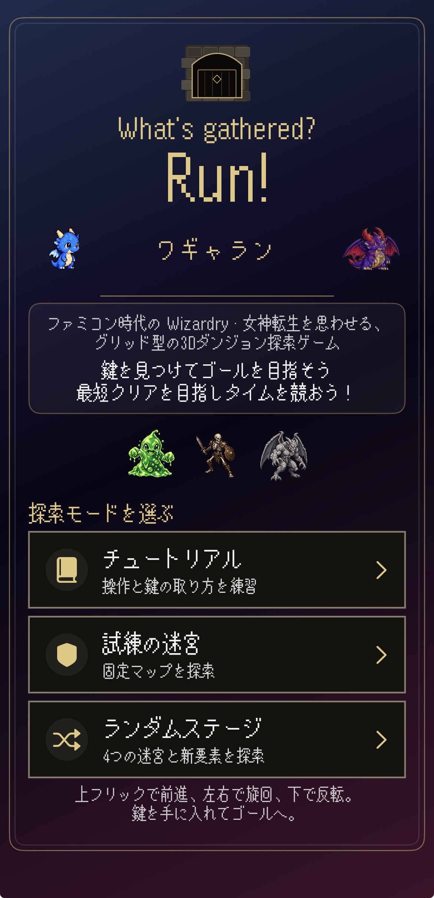
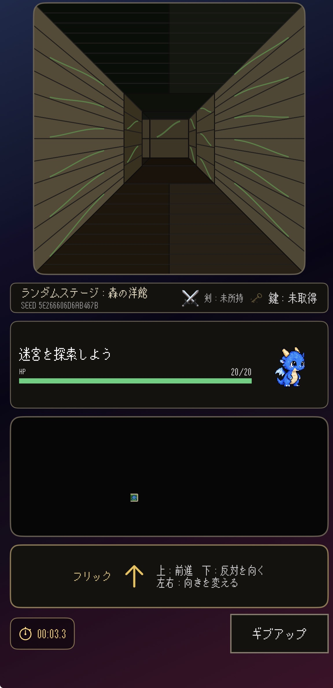
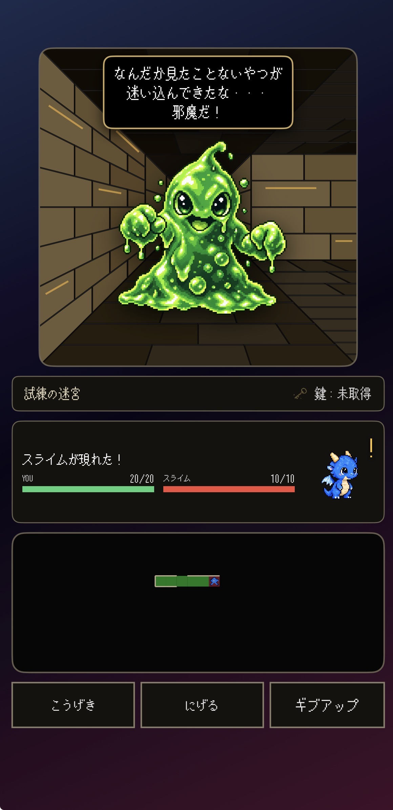
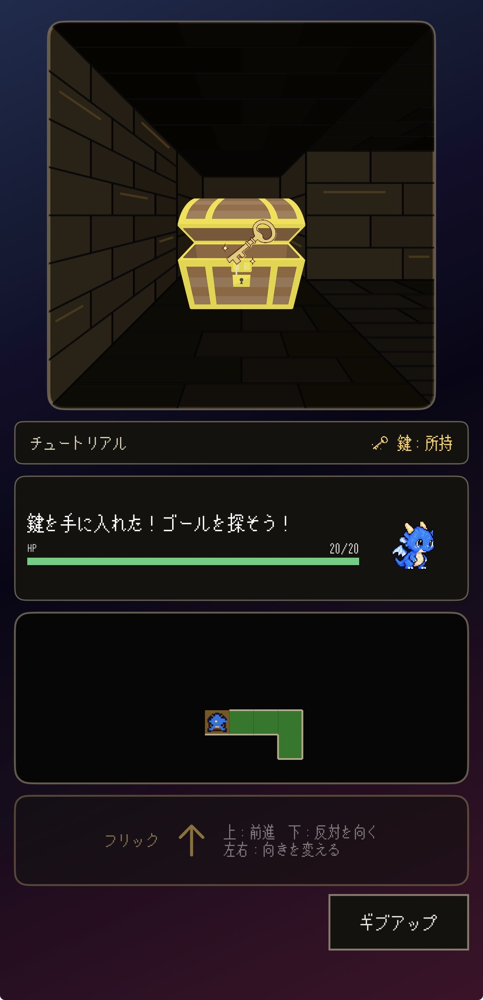
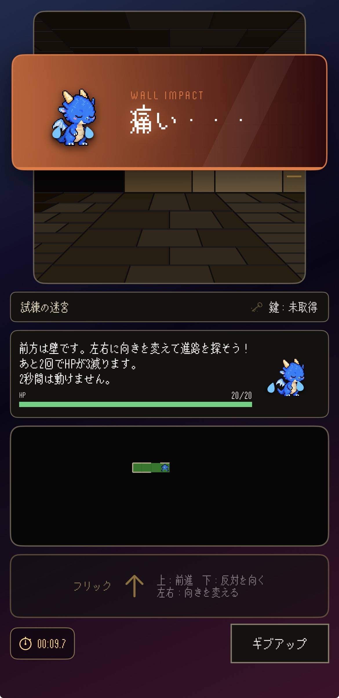
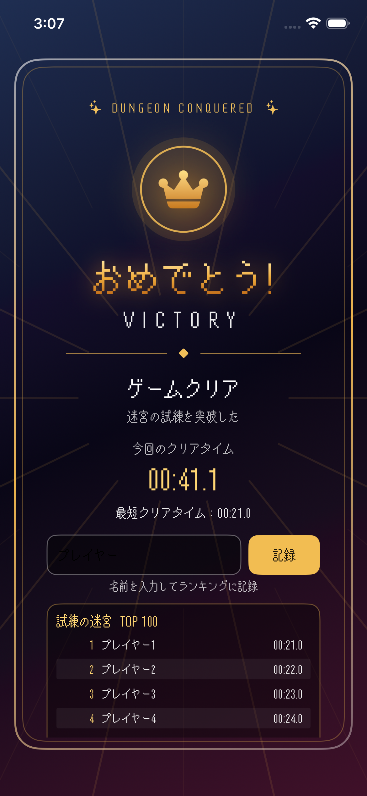
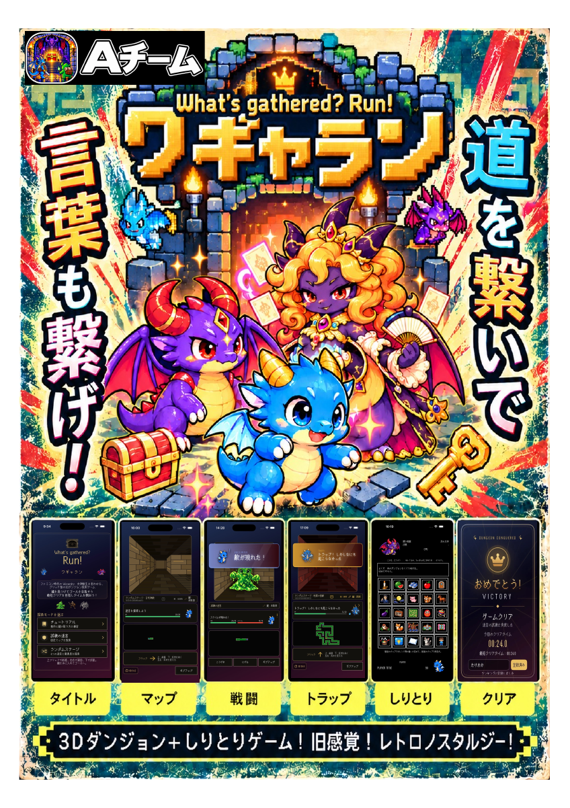

# What’s gathered? Run! — ワギャラン

**迷宮を探索し、カードしりとりで出口を切り開くiOSゲーム。**

剣や鍵を集めながら迷宮を進み、出口ではカードを使ったしりとりに挑戦します。探索と言葉遊びを、一つのゲームで楽しめる作品です。

## 画面紹介

<table>
<tr><th>タイトル</th><th>迷宮探索</th><th>戦闘</th></tr>
<tr><td> 遊ぶモードを選ぶ</td><td> 道を探して出口へ進む</td><td> 迷宮で出会った敵と戦う</td></tr>
<tr><th>鍵の取得</th><th>カットイン演出</th><th>クリア</th></tr>
<tr><td> 宝箱から出口の鍵を手に入れる</td><td> 壁にぶつかったことを表情と文字で伝える</td><td> クリアタイムやランキングを確認する</td></tr>
</table>

開発中の画面です。掲載画像は提供されたスクリーンショットで、現在の実装と表示が異なる場合があります。

## 作品紹介ポスター

[ポスターをPDFで見る](docs/portfolio/posters/作品紹介ポスター_20261026.pdf)（2026年10月26日版）

## 遊び方

1. **モードを選ぶ** — チュートリアルで操作を覚え、試練やランダムステージへ挑戦します。
2. **迷宮を探索する** — 画面をフリックして移動し、アイテムを集めながら敵や罠を乗り越えます。
3. **カードしりとりに挑む** — 出口でCPUと対戦し、クリアを目指します。

## 私の担当と工夫

担当は **SwiftUIを使った画面づくり・迷宮生成** です。SwiftUIは、iPhoneなどのアプリ画面を作るための仕組みです。

| 担当 | 工夫したこと |
|---|---|
| 画面づくり | タイトルから探索、結果表示まで、今の状況や次の操作を伝える画面を組み立てました。 |
| 迷宮生成 | 毎回違う迷宮を楽しめる仕組みと、同じ迷宮にもう一度挑戦できる仕組みを用意しました。 |

[作品紹介と開発の工夫を読む](docs/portfolio/作品紹介.md)

## 開発状況

現在開発中です。実際の端末での使い心地や、オンラインランキングの公開に向けた確認を進めています。

開発にはAIによる実装・レビュー・文書整理の支援を利用しています。このページに記載した個人の担当範囲は、画面づくりと迷宮生成です。

[使用フォントの利用条件](docs/licenses/MaruMonica利用条件.md)
