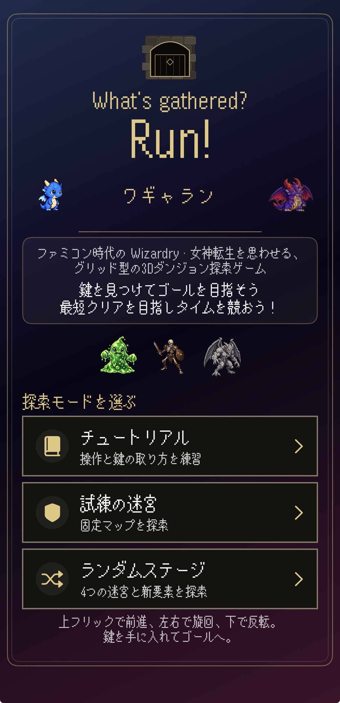
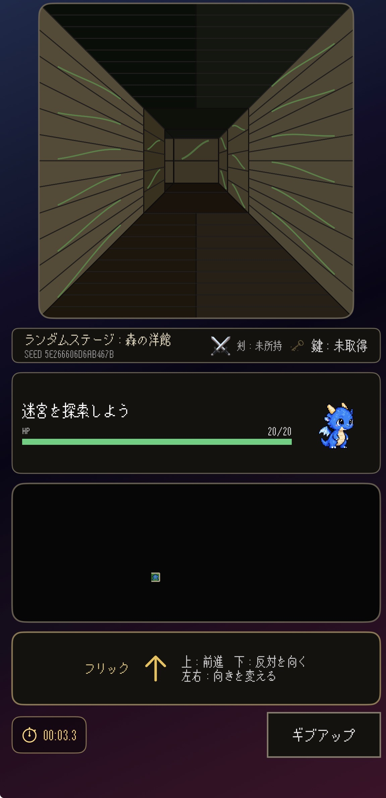
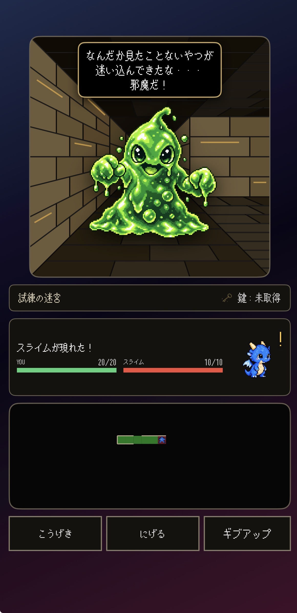
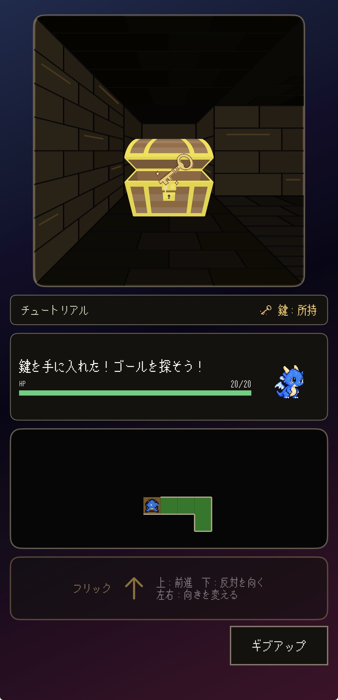
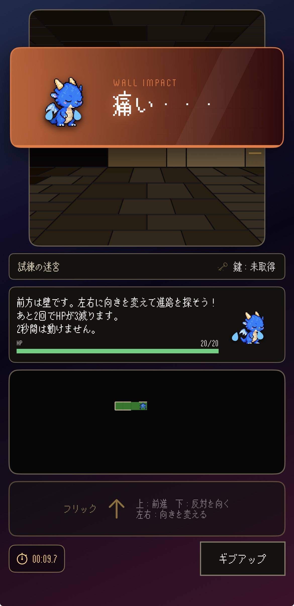
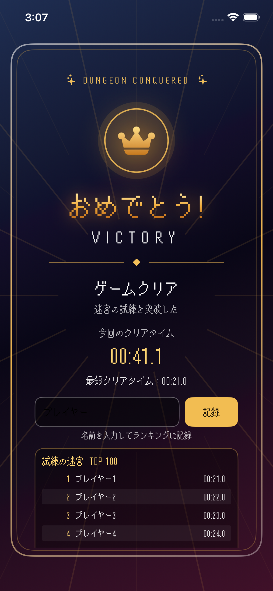
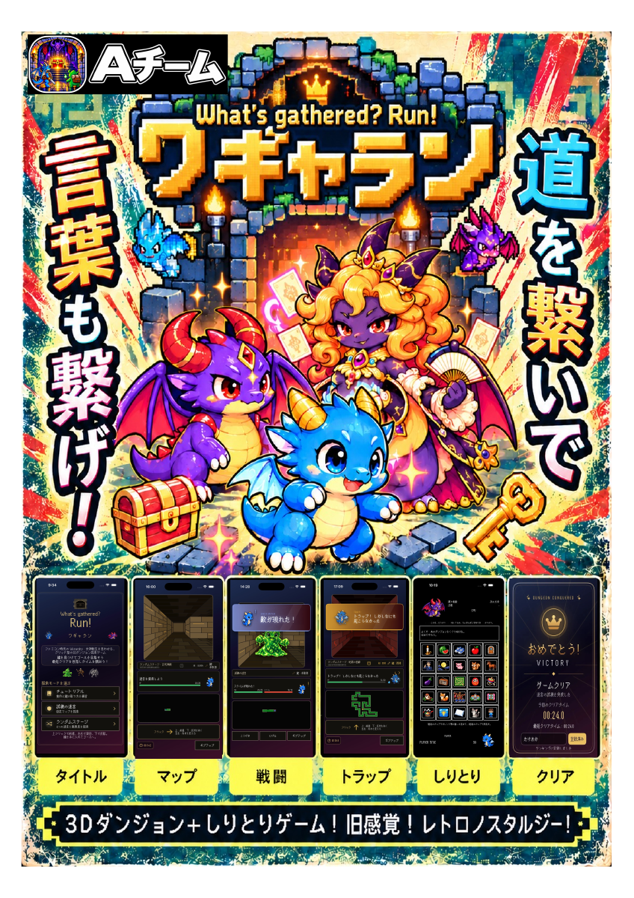

# 作品紹介と開発の工夫

[作品トップへ戻る](../../README.md)

## どんな作品か

「ワギャラン」は、迷宮探索とカードしりとりを組み合わせたiOSゲームです。道を探し、敵や罠を乗り越えたあと、出口では言葉を考えてカードを選ぶ遊びへ切り替わります。

初めて遊ぶ人はチュートリアルから始め、決まった迷宮の「試練」、毎回違う迷宮の「ランダムステージ」へ進めます。

## 私の担当範囲

**SwiftUIを使った画面づくり・迷宮生成**を担当しています。

| 担当 | 取り組んだ内容 |
|---|---|
| 画面づくり | タイトル、探索、結果表示などを組み立て、プレイヤーに状況と操作を伝えること。 |
| 迷宮生成 | 異なる迷宮を自動で作り、同じ条件でもう一度遊べるようにすること。 |

## 工夫1：遊びの状況が伝わる画面

探索、戦闘、カードしりとりでは、プレイヤーが見る情報や行う操作が変わります。そのため、それぞれの場面に合わせて画面を構成しています。

画面を作る際は、見た目に加えて「今どういう状態か」「次に何をすればよいか」を伝えることを意識しています。結果画面でもクリアタイムやランキングの状態が分かるようにしています。

## 工夫2：違う迷宮を楽しみ、同じ迷宮にも再挑戦できる

毎回同じ道では、攻略を覚えると新鮮さが薄れてしまいます。一方で、毎回違う道だけでは、もう一度同じ条件で挑戦することができません。

そこで、迷宮を作るための番号を使い、番号が同じなら同じ迷宮を作れる仕組みにしています。新しい迷宮を探索する楽しさと、同じ迷宮で攻略を考え直す遊び方を両立できます。

この仕組みは、問題が起きたときに同じ迷宮を作り直して原因を調べるためにも役立ちます。

## アプリづくりで大切にしたこと

- **利用する人の目線**：操作と表示をつなげ、状況を伝えること。
- **問題を直しやすい仕組み**：同じ条件を作り直し、原因を確認できること。
- **担当範囲を分かりやすく伝えること**：自分の担当と、プロジェクト全体の機能を区別すること。

これらを、ゲームだけでなく、使いやすいアプリを作るうえでも大切な観点として取り組んでいます。

## これから改善したいこと

実際の端末で操作のしやすさや画面の見やすさを確認し、使い心地を改善していきます。オンラインランキングも、公開に向けて準備中です。

開発にはAIによる実装・レビュー・文書整理の支援を利用しています。公開済みアプリの利用者数や運用実績を示すものではありません。

## 画面ギャラリー

<table>
<tr><th>タイトル</th><th>迷宮探索</th><th>戦闘</th></tr>
<tr><td> 遊ぶモードを選ぶ</td><td> 道を探して出口へ進む</td><td> 迷宮で出会った敵と戦う</td></tr>
<tr><th>鍵の取得</th><th>カットイン演出</th><th>クリア</th></tr>
<tr><td> 宝箱から出口の鍵を手に入れる</td><td> 壁にぶつかったことを表情と文字で伝える</td><td> クリアタイムやランキングを確認する</td></tr>
</table>

掲載画像は開発中のスクリーンショットです。最新の実装と表示が異なる場合があります。

## 作品紹介ポスター

[ポスターPDFを開く](posters/作品紹介ポスター_20261026.pdf)（2026年10月26日版）
